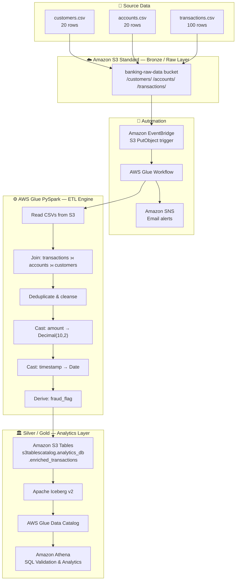
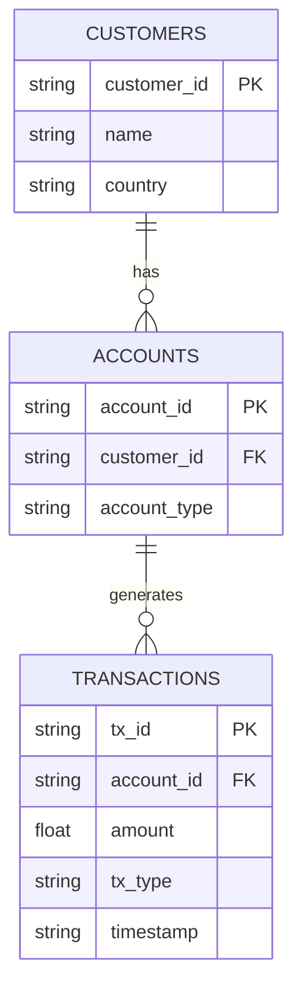

# 🏦 Banking Analytics Lakehouse

> An AWS-based banking analytics lakehouse that processes synthetic customer, account,
> and transaction data using AWS Glue PySpark — with a target architecture of Amazon S3 Tables
> backed by Apache Iceberg for analytics storage, AWS Glue Data Catalog for metadata,
> and Amazon Athena for SQL validation.


---

## Table of Contents

1. [Project Overview](#project-overview)
2. [Business Objective](#business-objective)
3. [Architecture](#architecture)
4. [AWS Services](#aws-services)
5. [Data Model](#data-model)
6. [Data Generation](#data-generation)
7. [ETL Flow](#etl-flow)
8. [Data Enrichment](#data-enrichment)
9. [S3 Tables & Apache Iceberg](#s3-tables--apache-iceberg)
10. [Athena Validation](#athena-validation)
11. [Implementation Status](#implementation-status)
12. [Repository Structure](#repository-structure)
13. [Setup](#setup)
14. [Security](#security)
15. [Future Enhancements](#future-enhancements)
16. [Project Specification](#project-specification)

---

## Project Overview

**Banking Analytics Lakehouse** is a cloud-native data engineering POC built on AWS.
It demonstrates end-to-end batch data processing using a Medallion Architecture:

| Layer | Technology | Content |
|---|---|---|
| **Bronze** | Amazon S3 Standard | Raw CSV files (customers, accounts, transactions) |
| **Silver/Gold** | Amazon S3 Tables + Apache Iceberg | Enriched, joined, fraud-flagged analytics table |

The project processes synthetic banking data through AWS Glue PySpark, applies
data quality rules and fraud detection logic, and stores analytics-ready results
in an Apache Iceberg table queryable via Amazon Athena.

> **⚠️ Implementation Note:** This repository represents a capstone/POC project.
> The data generation script and sample datasets are fully implemented and provided.
> The AWS pipeline components (Glue, S3 Tables, Athena) are specified and documented
> in the project report; deployment artifacts are referenced but not all included
> as standalone files in this repository.
> See [Implementation Status](#implementation-status) for the complete breakdown.

---

## Business Objective

Banking organizations process large volumes of transactional data from multiple
sources. This project addresses core data engineering challenges:

| Challenge | Solution |
|---|---|
| Scalable ingestion of transaction data | Batch CSV → S3 landing zone |
| Automated ETL orchestration | AWS Glue Workflow + EventBridge |
| Analytics-ready storage | Apache Iceberg on S3 Tables |
| SQL-based validation | Amazon Athena |
| Fraud transaction identification | Rule-based flag in PySpark |
| Operational monitoring | Amazon SNS notifications |

This is a **data engineering** project focused on:
- data ingestion architecture
- transformation logic (join, cleanse, cast)
- lakehouse storage design (Medallion)
- Iceberg table format
- SQL analytics and validation

---

## Architecture



---

## AWS Services

| Service | Role | Layer |
|---|---|---|
| Amazon S3 Standard | Raw data landing zone | Bronze |
| AWS Glue (PySpark) | ETL engine — read, join, transform, load | ETL |
| AWS Glue Workflow | Automated ETL orchestration | Automation |
| Amazon EventBridge | Event-driven S3 trigger | Automation |
| Amazon SNS | Email notifications (job success/failure) | Monitoring |
| Amazon S3 Tables | Managed Apache Iceberg storage | Silver/Gold |
| Apache Iceberg | ACID-compliant open table format | Silver/Gold |
| AWS Glue Data Catalog | Schema metadata registry | Catalog |
| Amazon Athena | Serverless SQL analytics | Analytics |
| Amazon DynamoDB | Incremental load watermark tracking | ETL |

---

## Data Model

Three source datasets form a customer → account → transaction hierarchy:



> **Dataset Note:** The capstone specification defines optional `email` (customers)
> and `balance` (accounts) fields. The synthetic dataset generated for this
> implementation does not include these columns. See [docs/data-model.md](docs/data-model.md).

### Dataset Statistics

| Dataset | Rows | Nulls | Duplicates |
|---|---|---|---|
| `customers.csv` | 20 | 0 | 0 |
| `accounts.csv` | 20 | 0 | 0 |
| `transactions.csv` | 100 | 0 | 0 |

---

## Data Generation

**Implementation Status: ✅ IMPLEMENTED / PROVIDED**

Synthetic datasets are generated by the included Python script:

```bash
# Install dependencies
pip install -r requirements.txt

# Generate datasets (writes to data/sample/)
python src/data_generation/generate_banking_data.py

# Custom: 500 transactions
python src/data_generation/generate_banking_data.py --records 500
```

### Generation Logic

| Dataset | Count | Logic |
|---|---|---|
| Customers | 20 | IDs: `CUST_001`–`CUST_020`; countries: random from USA/UK/India/Germany |
| Accounts | 20 | IDs: `ACC_001`–`ACC_020`; types: random Savings/Current |
| Transactions | 100 | TX_NNNNN; amount: 10.00–5000.00; date: random within past 30 days |

---

## ETL Flow

**Implementation Status: 📄 DOCUMENTED IN PROJECT REPORT**

```
EXTRACT                    TRANSFORM                    LOAD
──────────                 ──────────────────────────   ─────────────────────
customers.csv  ──┐
accounts.csv   ──┼──► Join all 3 tables ──► Cleanse ──► enriched_transactions
transactions.csv ┘         ↓                             (Apache Iceberg / S3 Tables)
                      Cast types
                           ↓
                      Add fraud_flag
```

### Key Transformations

1. **Join** — `transactions ⟕ accounts ⟕ customers` on FK relationships
2. **Deduplicate** — `dropDuplicates()`
3. **Filter** — Remove null/zero amounts
4. **Cast** — `amount → Decimal(10,2)`, `timestamp → Date`
5. **Fraud Detection** — `fraud_flag = 'Y'` when `amount > 4000`

---

## Data Enrichment

The Glue ETL joins three source tables to produce the enriched output:

```
transactions (tx_id, account_id, amount, tx_type, timestamp)
    │ join on account_id
    ▼
accounts (account_id, customer_id, account_type)
    │ join on customer_id
    ▼
customers (customer_id, name, country)
    │
    ▼
enriched_transactions:
  tx_id | account_id | customer_id | name | country |
  account_type | amount (Decimal) | tx_type | tx_date | fraud_flag
```

---

## S3 Tables & Apache Iceberg

**Implementation Status: 📄 DOCUMENTED IN PROJECT REPORT**

Amazon S3 Tables provides managed Apache Iceberg storage. Key distinctions:

| Feature | Standard S3 | Amazon S3 Tables |
|---|---|---|
| ACID transactions | ❌ | ✅ |
| Automatic Compaction | ❌ | ✅ |
| Schema evolution | Manual | ✅ Native |
| Time travel | ❌ | ✅ Native |
| Athena access | Via crawler | ✅ Direct |

### Target Configuration

```
Table Bucket : banking-lakehouse-<suffix>
Namespace   : analytics_db
Table       : enriched_transactions
Catalog     : s3tablescatalog
Format      : Apache Iceberg v2
```

> **[SCREENSHOT REQUIRED]** S3 Table Bucket → analytics_db → enriched_transactions

> **Automatic Compaction:** [REQUIRED VERIFICATION — RESULT NOT PROVIDED]

---

## Athena Validation

**Implementation Status: ⚠️ QUERIES PROVIDED — EXECUTION RESULTS NOT PROVIDED**

### Test 1 — Data Integrity

```sql
SELECT count(*)
FROM "s3tablescatalog"."analytics_db"."enriched_transactions";
```

### Test 2 — Top 3 Customers by Credit Volume

```sql
SELECT name,
       sum(amount) AS total_volume
FROM "s3tablescatalog"."analytics_db"."enriched_transactions"
WHERE tx_type = 'Credit'
GROUP BY name
ORDER BY total_volume DESC
LIMIT 3;
```

> **⚠️ Assignment Note:** The business requirement specifies "last 30 days."
> The provided SQL filters only by `tx_type`. An improved version with the
> date filter is in [`sql/athena/validation_queries.sql`](sql/athena/validation_queries.sql).

### Test 3 — Fraud Analysis

```sql
SELECT fraud_flag, count(*) AS transaction_count
FROM "s3tablescatalog"."analytics_db"."enriched_transactions"
GROUP BY fraud_flag;
```

---

## Implementation Status

| Component | Status |
|---|---|
| ✅ Synthetic data generation (Python) | **IMPLEMENTED / PROVIDED** |
| ✅ Sample datasets (customers, accounts, transactions) | **PROVIDED** |
| 📄 S3 raw bucket configuration | **DOCUMENTED IN PROJECT REPORT** |
| 📄 AWS Glue PySpark ETL script | **DOCUMENTED IN PROJECT REPORT** |
| 📄 Fraud detection logic | **DOCUMENTED IN PROJECT REPORT** |
| 📄 Amazon S3 Tables + Iceberg | **DOCUMENTED IN PROJECT REPORT** |
| 📄 AWS Glue Workflow automation | **DOCUMENTED IN PROJECT REPORT** |
| 📄 Amazon EventBridge trigger | **DOCUMENTED IN PROJECT REPORT** |
| 📄 Amazon SNS notifications | **DOCUMENTED IN PROJECT REPORT** |
| 📄 DynamoDB watermark tracking | **DOCUMENTED IN PROJECT REPORT** |
| ⚠️ Athena validation results | **RESULT NOT PROVIDED** |
| ⚠️ Automatic Compaction verification | **VERIFICATION NOT PROVIDED** |
| ⚠️ `email` / `balance` fields | **NOT IN GENERATED DATASET** |
| 🔮 Automated test suite | **RECOMMENDED** |
| 🔮 Infrastructure as Code | **RECOMMENDED** |

> **Full details:** [docs/implementation-status.md](docs/implementation-status.md)

---

## Repository Structure

```
banking-analytics-lakehouse/
│
├── README.md                          ← You are here
├── LICENSE
├── SECURITY.md                        ← Security policy
├── .gitignore
├── .env.example                       ← Environment variable template
├── requirements.txt
│
├── notebooks/
│   └── Bank_Analytics_Project.ipynb  ← Original notebook (reference)
│
├── src/
│   ├── data_generation/
│   │   └── generate_banking_data.py  ← ✅ Refactored generator (CLI)
│   └── glue/
│       └── banking_lakehouse_etl.py  ← Reference Glue ETL script
│
├── data/
│   ├── sample/
│   │   ├── customers.csv             ← ✅ 20 rows
│   │   ├── accounts.csv              ← ✅ 20 rows
│   │   └── transactions.csv          ← ✅ 100 rows
│   └── README.md
│
├── sql/
│   └── athena/
│       ├── validation_queries.sql    ← Count + top-3 + fraud queries
│       └── business_queries.sql      ← Additional analytics
│
├── infrastructure/
│   ├── s3/README.md                  ← S3 raw bucket setup guide
│   ├── s3-tables/README.md           ← S3 Table Bucket setup guide
│   ├── glue/README.md                ← Glue job configuration guide
│   └── athena/README.md              ← Athena workgroup guide
│
├── docs/
│   ├── architecture.md               ← Mermaid architecture + components
│   ├── data-model.md                 ← ER diagram + schema details
│   ├── data-generation.md            ← Generator documentation
│   ├── etl-pipeline.md               ← ETL flow documentation
│   ├── s3-tables.md                  ← S3 Tables + Iceberg details
│   ├── athena-validation.md          ← Validation queries + notes
│   ├── data-lineage.md               ← Column-level lineage
│   ├── implementation-status.md      ← Full status table
│   └── future-enhancements.md        ← Recommended improvements
│
├── screenshots/
│   ├── s3/                           ← [SCREENSHOTS REQUIRED]
│   ├── s3-tables/                    ← [SCREENSHOTS REQUIRED]
│   ├── glue/                         ← [SCREENSHOTS REQUIRED]
│   └── athena/                       ← [SCREENSHOTS REQUIRED]
│
├── tests/
│   └── test_data_generation.py       ← Recommended test suite
│
└── reports/
    └── capstone-specification.pdf    ← Official POC specification
```

---

## Setup

### Local Reproduction (Data Generation)

```bash
# 1. Clone the repository
git clone https://github.com/<your-username>/banking-analytics-lakehouse.git
cd banking-analytics-lakehouse

# 2. Create and activate Python virtual environment
python -m venv .venv

# Windows
.venv\Scripts\activate
# macOS/Linux
source .venv/bin/activate

# 3. Install dependencies
pip install -r requirements.txt

# 4. Generate sample datasets
python src/data_generation/generate_banking_data.py

# 5. Inspect generated files
python -c "import pandas as pd; print(pd.read_csv('data/sample/transactions.csv').head())"

# 6. (Optional) Run recommended tests
pytest tests/ -v
```

### AWS Reproduction (Full Pipeline)

> ⚠️ AWS services incur costs. Ensure you understand pricing before deploying.
> Data generation (above) can be performed entirely locally without AWS access.

```bash
# Step 1 — Configure AWS credentials
aws configure
# Or: cp .env.example .env && edit .env

# Step 2 — Create S3 raw bucket
aws s3 mb s3://banking-raw-data-<your-suffix> --region us-east-1

# Step 3 — Upload raw CSVs
aws s3 cp data/sample/customers.csv    s3://banking-raw-data-<suffix>/customers/
aws s3 cp data/sample/accounts.csv     s3://banking-raw-data-<suffix>/accounts/
aws s3 cp data/sample/transactions.csv s3://banking-raw-data-<suffix>/transactions/
aws s3 cp src/glue/banking_lakehouse_etl.py s3://banking-raw-data-<suffix>/scripts/

# Step 4 — Create S3 Table Bucket (via AWS Console — S3 Tables section)
#   Name: banking-lakehouse-<suffix>
#   Namespace: analytics_db

# Step 5 — Configure and run Glue ETL job
#   See: infrastructure/glue/README.md
#   Update bucket names in banking_lakehouse_etl.py
#   Upload script, create Glue job, add --datalake-formats iceberg parameter

# Step 6 — Verify Iceberg table in S3 Tables console

# Step 7 — Run Athena validation queries
#   See: sql/athena/validation_queries.sql

# Step 8 — Verify Automatic Compaction setting in S3 Tables console
```

---

## Security

- ✅ No real customer data — all datasets are fully synthetic
- ✅ No AWS credentials committed — use `.env` (gitignored) or IAM roles
- ✅ No personal filesystem paths in any script
- ✅ `.env.example` contains placeholders only
- ✅ `.gitignore` blocks `*.pem`, `*.key`, `.env`, credentials

See [SECURITY.md](SECURITY.md) for the full security policy.

---

## Future Enhancements

| Enhancement | Priority |
|---|---|
| Add `email` and `balance` fields to datasets | Medium |
| Explicit 30-day timestamp filter in business query | High |
| Infrastructure as Code (CloudFormation / Terraform) | High |
| CI/CD pipeline (GitHub Actions) | High |
| Incremental load with DynamoDB watermark | Medium |
| Automated data quality framework | Medium |
| Iceberg table partitioning by `tx_date` | Medium |
| Gold layer aggregation tables | Low |
| ML-based fraud detection (SageMaker) | Low |
| Real-time streaming (Amazon Kinesis) | Low |
| Amazon QuickSight dashboard | Low |

See [docs/future-enhancements.md](docs/future-enhancements.md) for details.

---

## Project Specification

The official capstone specification is stored at:

```
reports/capstone-specification.pdf
```

> **Note:** This document is the original assignment/project report submitted
> for the AWS Data Engineering capstone. It defines the project requirements
> and documents the implemented components.

---

<div align="center">

**Banking Analytics Lakehouse** · AWS Data Engineering Capstone POC  
Built with ☁️ AWS Glue · Apache Iceberg · Amazon S3 Tables · Amazon Athena

</div>
