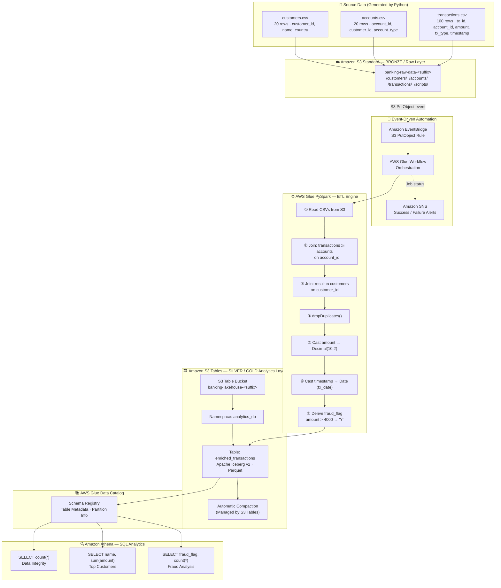

# Architecture Diagram — Banking Analytics Lakehouse

## Medallion Architecture Overview

---

## Component Descriptions

| Component | AWS Service | Layer | Role |
|---|---|---|---|
| Source CSVs | Python generator | Input | Synthetic data |
| Raw S3 bucket | Amazon S3 Standard | Bronze | Landing zone |
| Event trigger | Amazon EventBridge | Automation | S3 PutObject → Workflow |
| Orchestration | AWS Glue Workflow | Automation | Job sequencing |
| Alerts | Amazon SNS | Monitoring | Email notifications |
| ETL engine | AWS Glue (PySpark) | Transform | Join, cleanse, enrich |
| Analytics storage | Amazon S3 Tables | Silver/Gold | Managed Iceberg |
| Table format | Apache Iceberg v2 | Silver/Gold | ACID, time travel |
| Metadata | Glue Data Catalog | Catalog | Schema registry |
| SQL query | Amazon Athena | Analytics | Validation + BI |
