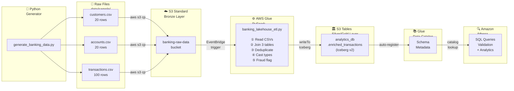
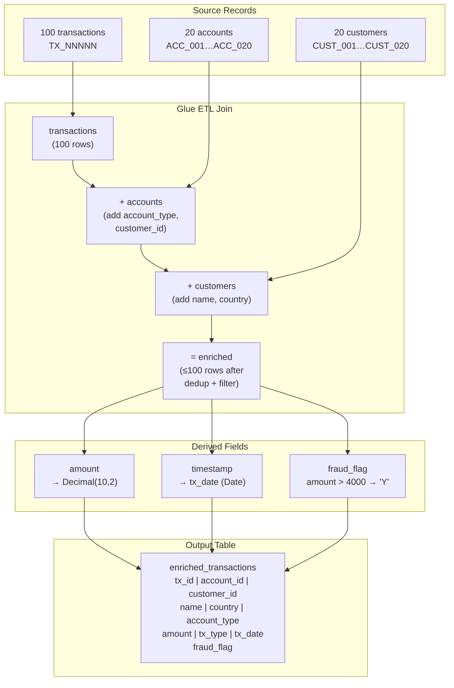

# Data Flow Diagram — Banking Analytics Lakehouse

## End-to-End Data Flow



---

## Record-Level Flow



---

## FK Relationship Flow

```
customers.customer_id  (PK, 20 values)
    │
    │ referenced by
    ▼
accounts.customer_id   (FK → 20 unique values)
accounts.account_id    (PK, 20 values: ACC_001…ACC_020)
    │
    │ referenced by
    ▼
transactions.account_id  (FK → random 20 values, 100 rows total)
```
