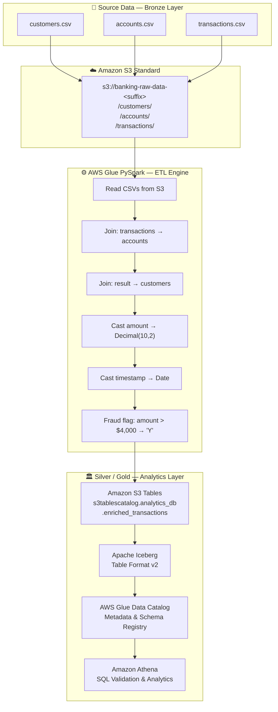

# Architecture — Banking Analytics Lakehouse

## 1. Objective

Design and implement a cloud-native banking analytics lakehouse on AWS that:

- Ingests synthetic banking transaction CSV files
- Transforms them using AWS Glue PySpark
- Stores analytics-ready data in Amazon S3 Tables (Apache Iceberg)
- Enables SQL analytics via Amazon Athena

---

## 2. Architecture Diagram



---

## 3. Architecture Components

| Component | AWS Service | Purpose |
|---|---|---|
| Raw Landing Zone | Amazon S3 Standard | Stores CSV files uploaded before ETL |
| ETL Engine | AWS Glue (PySpark) | Reads, joins, transforms, and loads data |
| Workflow Orchestration | AWS Glue Workflow | Automates ETL job sequencing |
| Event Trigger | Amazon EventBridge | Triggers workflow on S3 upload events |
| Notification | Amazon SNS | Email alerts for job success/failure |
| Lakehouse Storage | Amazon S3 Tables | Managed Iceberg storage layer |
| Table Format | Apache Iceberg | ACID-compliant, version 2 table format |
| Metadata Catalog | AWS Glue Data Catalog | Schema registry enabling Athena queries |
| Query Engine | Amazon Athena | Serverless SQL analytics |
| Watermark Tracking | Amazon DynamoDB | Tracks last processed timestamp for incremental loads |

---

## 4. Data Flow

```
RAW CSVs (customers, accounts, transactions)
    │
    ▼ Upload
Amazon S3 Standard — Bronze / Raw Layer
    │
    ▼ EventBridge trigger (S3 PUT event)
AWS Glue Workflow
    │
    ▼ ETL Job (PySpark)
    ├── Read all 3 CSVs
    ├── Join: transactions ⟕ accounts ⟕ customers
    ├── Deduplicate
    ├── Cast amount → Decimal(10,2)
    ├── Cast timestamp → Date
    └── Add fraud_flag (amount > 4000)
    │
    ▼ Write (Iceberg v2)
Amazon S3 Tables — Silver / Gold Analytics Layer
    │
    ▼ Metadata registered
AWS Glue Data Catalog
    │
    ▼ SQL queries
Amazon Athena
    │
    ▼ Validation & business analytics
```

---

## 5. Medallion Architecture

### Bronze Layer — Raw / Landing

- **Storage:** Amazon S3 Standard bucket
- **Format:** Raw CSV files as uploaded
- **Content:** Unmodified source data

### Silver / Gold Layer — Analytics

- **Storage:** Amazon S3 Tables (managed Iceberg)
- **Format:** Apache Iceberg v2 (Parquet under the hood)
- **Content:** Enriched, joined, cleaned, fraud-flagged transactions
- **Table:** `s3tablescatalog.analytics_db.enriched_transactions`

---

## 6. Event-Driven Automation

The specification describes an automated pipeline:

```
CSV file uploaded to S3
    │
    ▼
Amazon EventBridge Rule
(monitors s3:PutObject events)
    │
    ▼
AWS Glue Workflow triggered
    │
    ▼
Glue ETL Job executes automatically
    │
    ▼
Amazon SNS notification sent (success / failure)
```

> **Implementation Status:** The event-driven automation components (EventBridge, SNS, DynamoDB watermark) are described in the project report. Artifacts verifying deployed EventBridge rules and SNS topics are not included in the supplied files.

---

## 7. Incremental Load Design

The specification describes a DynamoDB-backed watermark tracking system:

- **DynamoDB Table:** `banking_watermark`
- **Purpose:** Stores the last processed timestamp to enable incremental loads
- **Benefit:** Avoids full dataset reload on every ETL run

> **Implementation Status:** [SPECIFIED IN POC REPORT — ARTIFACT NOT PROVIDED]

---

## 8. Implementation Status Summary

| Architecture Component | Status |
|---|---|
| Synthetic data generation (Python) | ✅ IMPLEMENTED / PROVIDED |
| S3 raw landing zone | ⚠️ SPECIFIED — ARTIFACT NOT PROVIDED |
| AWS Glue PySpark ETL script | ✅ DOCUMENTED IN PROJECT REPORT |
| Join/transform/fraud flag logic | ✅ DOCUMENTED IN PROJECT REPORT |
| Amazon S3 Tables (Iceberg) | ⚠️ SPECIFIED — ARTIFACT NOT PROVIDED |
| Glue Data Catalog integration | ⚠️ SPECIFIED — ARTIFACT NOT PROVIDED |
| Amazon Athena validation | ⚠️ SPECIFIED — RESULT NOT PROVIDED |
| AWS Glue Workflow automation | ⚠️ SPECIFIED — ARTIFACT NOT PROVIDED |
| Amazon EventBridge trigger | ⚠️ SPECIFIED — ARTIFACT NOT PROVIDED |
| Amazon SNS notifications | ⚠️ SPECIFIED — ARTIFACT NOT PROVIDED |
| DynamoDB watermark tracking | ⚠️ SPECIFIED — ARTIFACT NOT PROVIDED |

See [implementation-status.md](implementation-status.md) for the full status table.
