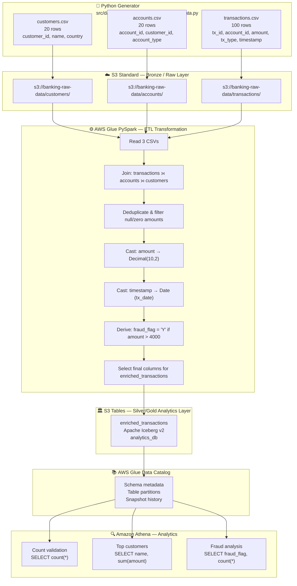

# Data Lineage — Banking Analytics Lakehouse

## Overview

This document traces the lineage of data from its synthetic generation source
through the AWS pipeline to final analytical consumption.

---

## End-to-End Data Lineage Diagram



---

## Column-Level Lineage

### `enriched_transactions` — Column Origins

| Column | Source Table | Source Column | Transformation |
|---|---|---|---|
| `tx_id` | transactions | `tx_id` | None (pass-through) |
| `account_id` | transactions | `account_id` | None (join key) |
| `customer_id` | accounts | `customer_id` | Resolved via join |
| `name` | customers | `name` | Resolved via join |
| `country` | customers | `country` | Resolved via join |
| `account_type` | accounts | `account_type` | Resolved via join |
| `amount` | transactions | `amount` | `cast(Decimal(10,2))` |
| `tx_type` | transactions | `tx_type` | None (pass-through) |
| `tx_date` | transactions | `timestamp` | `to_date(timestamp)` |
| `fraud_flag` | — | — | Derived: `when(amount > 4000, 'Y').otherwise('N')` |

---

## Join Lineage

```
transactions (100 rows)
    │
    │ LEFT JOIN on account_id
    ▼
accounts (20 rows)
    │
    │ LEFT JOIN on customer_id
    ▼
enriched_transactions
(up to 100 rows after dedup/filter)
```

Each transaction gains:
- Account attributes (`account_type`) from the accounts join
- Customer attributes (`name`, `country`) from the customers join

---

## Data Quality Checkpoints

| Stage | Check | Applied By |
|---|---|---|
| Raw generation | No nulls, valid FK refs | Python generator |
| ETL cleansing | `dropDuplicates()` | Glue PySpark |
| ETL cleansing | `filter(amount > 0)` | Glue PySpark |
| ETL type safety | `cast(Decimal(10,2))` | Glue PySpark |
| ETL type safety | `to_date(timestamp)` | Glue PySpark |
| Athena validation | `count(*)` check | Athena SQL |

---

## Lineage Summary Table

| Step | Input | Process | Output | Status |
|---|---|---|---|---|
| 1 | — | Python data generator | 3 CSV files (140 rows total) | ✅ PROVIDED |
| 2 | CSVs | S3 upload | Bronze raw bucket | ⚠️ ARTIFACT NOT PROVIDED |
| 3 | S3 CSVs | Glue ETL (PySpark) | enriched_transactions | ⚠️ ARTIFACT NOT PROVIDED |
| 4 | Iceberg table | Glue Data Catalog | Schema metadata | ⚠️ ARTIFACT NOT PROVIDED |
| 5 | Metadata | Athena SQL | Analytics results | ⚠️ RESULT NOT PROVIDED |
