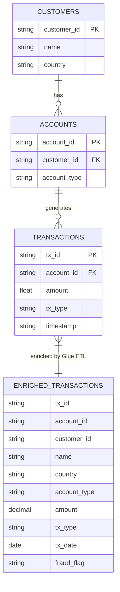

# Data Model — Banking Analytics Lakehouse

## Overview

The Banking Analytics Lakehouse uses three source tables that form a
customer → account → transaction hierarchy.

---

## Entity-Relationship Diagram



---

## Source Tables

### 1. `customers`

| Column | Data Type | Constraints | Description |
|---|---|---|---|
| `customer_id` | String | PK, NOT NULL | Format: `CUST_001`…`CUST_020` |
| `name` | String | NOT NULL | Synthetic name: `User_1`…`User_20` |
| `country` | String | NOT NULL | `USA`, `UK`, `India`, or `Germany` |

**Rows:** 20  
**Nulls:** 0  
**Duplicates:** 0

> ⚠️ **Specification vs Implementation Note:**  
> The capstone specification defines an `email` column in the Customers dataset.  
> The actual synthetic dataset generated for this implementation **does not include `email`**.  
> This is documented accurately here and is listed as a recommended future enhancement.

---

### 2. `accounts`

| Column | Data Type | Constraints | Description |
|---|---|---|---|
| `account_id` | String | PK, NOT NULL | Format: `ACC_001`…`ACC_020` |
| `customer_id` | String | FK → customers, NOT NULL | Maps to a customer |
| `account_type` | String | NOT NULL | `Savings` or `Current` |

**Rows:** 20  
**Nulls:** 0  
**Duplicates:** 0  
**Relationship:** 1 account per customer (1:1 in this dataset; logically 1:N)

> ⚠️ **Specification vs Implementation Note:**  
> The capstone specification defines a `balance` column in the Accounts dataset.  
> The actual synthetic dataset **does not include `balance`**.  
> Listed as a recommended future enhancement.

---

### 3. `transactions`

| Column | Data Type | Constraints | Description |
|---|---|---|---|
| `tx_id` | String | PK, NOT NULL | Format: `TX_NNNNN` |
| `account_id` | String | FK → accounts, NOT NULL | Maps to an account |
| `amount` | Float | NOT NULL, > 0 | Range: `10.00`–`5000.00` |
| `tx_type` | String | NOT NULL | `Credit` or `Debit` |
| `timestamp` | String | NOT NULL | ISO datetime within previous 30 days |

**Rows:** 100  
**Nulls:** 0  
**Duplicates:** 0

---

## Output Table (Post-ETL)

After the Glue ETL job runs, an enriched table is written to Amazon S3 Tables:

### `s3tablescatalog.analytics_db.enriched_transactions`

| Column | Data Type | Source | Description |
|---|---|---|---|
| `tx_id` | String | transactions | Transaction ID |
| `account_id` | String | transactions | Account reference |
| `customer_id` | String | accounts | Customer reference (joined) |
| `name` | String | customers | Customer name (joined) |
| `country` | String | customers | Customer country (joined) |
| `account_type` | String | accounts | Savings or Current (joined) |
| `amount` | Decimal(10,2) | transactions | Cast from Float |
| `tx_type` | String | transactions | Credit or Debit |
| `tx_date` | Date | transactions | Cast from timestamp string |
| `fraud_flag` | String | Derived | `Y` if amount > 4000, else `N` |

> **Implementation Status:** The enriched_transactions schema is derived from the Glue ETL script documented in the project report.  
> Actual S3 Tables artifact/screenshot: [NOT PROVIDED IN SUPPLIED FILES]

---

## Key Relationships

```
customers.customer_id  (PK)
        │
        │ 1 customer → 1+ accounts
        ▼
accounts.customer_id   (FK)
accounts.account_id    (PK)
        │
        │ 1 account → many transactions
        ▼
transactions.account_id (FK)
```

---

## Specification Fields Not Implemented

| Field | Table | Specified? | Implemented? | Reason |
|---|---|---|---|---|
| `email` | customers | ✅ Yes | ❌ No | Not in generated dataset |
| `balance` | accounts | ✅ Yes | ❌ No | Not in generated dataset |

These fields can be added to the generator in a future enhancement.
See [future-enhancements.md](future-enhancements.md).
