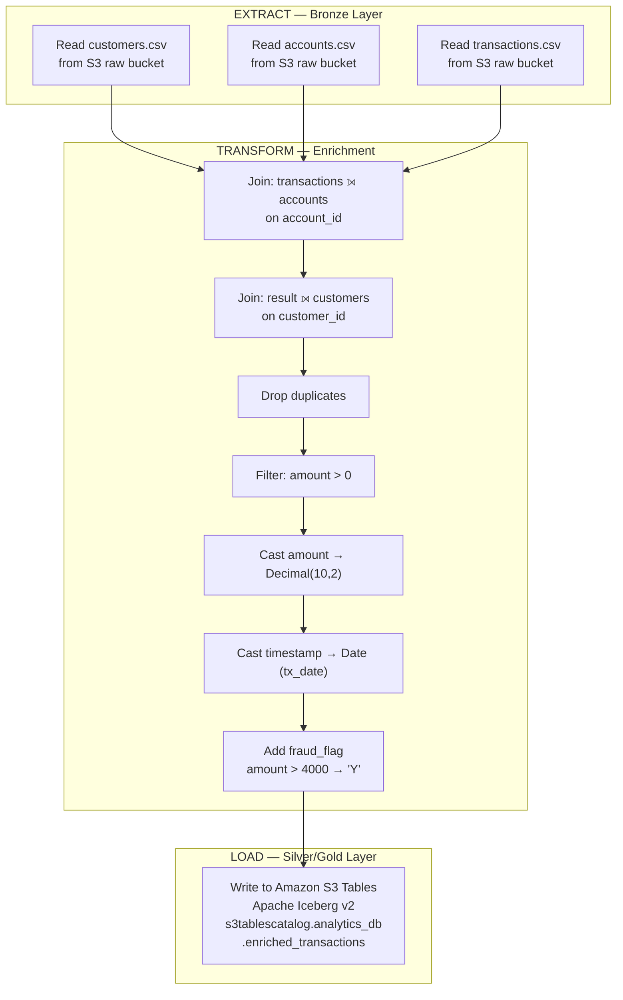

# ETL Pipeline — Banking Analytics Lakehouse

## Implementation Status

| Component | Status |
|---|---|
| ETL script documented in project report | ✅ DOCUMENTED IN PROJECT REPORT |
| Reference implementation in this repo | ✅ PROVIDED (see note below) |
| Verified deployed Glue job artifact | ⚠️ ARTIFACT NOT PROVIDED |

> **Important:** The ETL script in `src/glue/banking_lakehouse_etl.py` is a
> **reference implementation** derived from the Glue script documented in the
> project report. It is clearly labeled as such and should not be interpreted
> as independently verified deployed code.

---

## Pipeline Overview



---

## EXTRACT

The ETL job reads raw CSV files from the S3 landing bucket:

```python
customers    = spark.read.option("header", "true").csv("s3://banking-raw-data-<suffix>/customers/")
accounts     = spark.read.option("header", "true").csv("s3://banking-raw-data-<suffix>/accounts/")
transactions = spark.read.option("header", "true").csv("s3://banking-raw-data-<suffix>/transactions/")
```

---

## TRANSFORM

### 1. Join Transactions → Accounts → Customers

```python
df = (
    transactions
    .join(accounts,  "account_id")
    .join(customers, "customer_id")
)
```

The resulting DataFrame contains all transaction columns plus the joined
account and customer attributes.

### 2. Data Cleansing

```python
df = df.dropDuplicates()                           # Remove duplicate rows
df = df.filter(col("amount").isNotNull())          # Remove null amounts
df = df.filter(col("amount") > 0)                  # Remove non-positive amounts
```

### 3. Type Casting

```python
from pyspark.sql.types import DecimalType

df = df.withColumn("amount", col("amount").cast(DecimalType(10, 2)))
df = df.withColumn("tx_date", to_date(col("timestamp"), "yyyy-MM-dd HH:mm:ss"))
```

### 4. Fraud Detection Flag

Transactions with `amount > 4000` are flagged as suspicious:

```python
from pyspark.sql.functions import when

df = df.withColumn(
    "fraud_flag",
    when(col("amount") > 4000, "Y").otherwise("N")
)
```

> **Note:** This fraud detection rule is a simple threshold-based heuristic
> defined in the project specification. A production implementation would use
> more sophisticated ML-based fraud detection.

---

## LOAD

The enriched DataFrame is written to Amazon S3 Tables using Iceberg v2:

```python
df_enriched.writeTo("s3tablescatalog.analytics_db.enriched_transactions") \
    .tableProperty("format-version", "2") \
    .tableProperty("location", "s3://banking-lakehouse-<suffix>/enriched_transactions/") \
    .createOrReplace()
```

### Output Schema — `enriched_transactions`

| Column | Type | Description |
|---|---|---|
| `tx_id` | String | Transaction ID |
| `account_id` | String | Account reference |
| `customer_id` | String | Customer reference |
| `name` | String | Customer name |
| `country` | String | Customer country |
| `account_type` | String | Savings / Current |
| `amount` | Decimal(10,2) | Transaction amount |
| `tx_type` | String | Credit / Debit |
| `tx_date` | Date | Transaction date |
| `fraud_flag` | String | Y / N |

---

## Glue Job Configuration

### Required Parameters

| Parameter | Value |
|---|---|
| Glue version | Glue 4.0 |
| Worker type | G.1X or G.2X |
| `--datalake-formats` | `iceberg` |
| `--conf` | `spark.sql.catalog.s3tablescatalog=...` |

### Iceberg Catalog Configuration

The Glue job requires Iceberg catalog configuration in the Spark session:

```python
spark = SparkSession.builder \
    .appName("BankingLakehouse") \
    .config("spark.sql.catalog.s3tablescatalog",
            "org.apache.iceberg.spark.SparkCatalog") \
    .config("spark.sql.catalog.s3tablescatalog.catalog-impl",
            "software.amazon.s3tables.iceberg.S3TablesCatalog") \
    .config("spark.sql.extensions",
            "org.apache.iceberg.spark.extensions.IcebergSparkSessionExtensions") \
    .getOrCreate()
```

---

## Workflow Automation

The specification describes automated orchestration using **AWS Glue Workflow**:

```
Start Trigger
    │
    ▼
Glue ETL Job (banking_lakehouse_etl)
    │
    ▼
Gold Aggregation Job (optional)
```

> **Implementation Status:** Glue Workflow described in project report.
> Deployed workflow artifact: [NOT PROVIDED]

---

## Event-Driven Trigger

The specification describes **Amazon EventBridge** triggering the workflow
automatically when new CSV files are uploaded to S3:

```
S3 PutObject event
    │
    ▼ EventBridge rule
AWS Glue Workflow → Glue ETL Job
```

> **Implementation Status:** EventBridge automation described in project report.
> Deployed EventBridge rule artifact: [NOT PROVIDED]

---

## Script Location

```
src/glue/banking_lakehouse_etl.py
```

See the inline comments in that file for configuration instructions.
